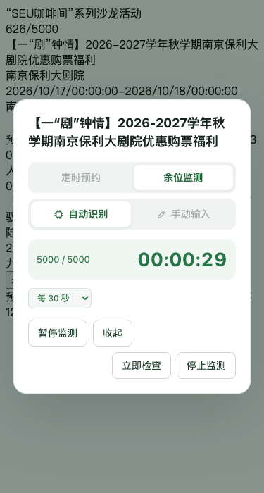
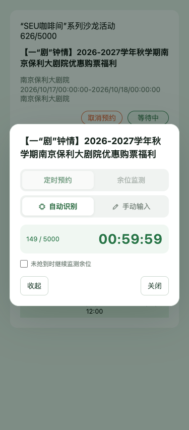

# SEU 研究生讲座预约助手

在活动列表和详情页原按钮旁增加“预约助手”，用独立弹窗完成倒计时、低频余位监测、本地 OCR／手动验证码、提交及结果核验。源码为 TypeScript 小项目，构建为单份油猴脚本。使用时只需要浏览器和用户脚本管理器，不需要本地服务、Python、Node 或 API 密钥。

v0.3.3 增加“立即检查”，放在“停止监测”左边；检查间隔修改从下一轮计时生效。监测默认使用自动识别，仅异常后开放手动输入。保留紧凑弹窗和满员失败恢复。

## 安装与使用

1. 在 Tampermonkey 等管理器中创建脚本，复制 [dist/seu-lecture-helper.user.js](dist/seu-lecture-helper.user.js) 全文并保存。
2. 登录当前 [研究生讲座系统](https://ehall.seu.edu.cn/gsapp/sys/yddjzxxtjappseu/*default/index.do#/hdyy)。脚本只匹配这一 HTTPS 应用。
3. 点击活动原按钮旁的“预约助手”。人数已满时默认选中余位监测并禁用定时预约；其他活动默认定时预约。确认选项后点击“开始等待”“立即预约”或“开始监测”；打开弹窗本身不会取验证码或提交。
4. 定时预约可选择“自动识别”或“手动输入”，倒计时期间即可切换，选择会保存在本浏览器。余位监测独立使用自动识别，默认禁用手动输入；模型加载、识别或验证码校验异常后，临时切回手动并开放选项，不修改定时预约偏好。
5. 自动模式会提前准备模型，取图后本地识别并自动提交；手动模式自行输入，按回车或点击“提交预约”。两种模式成功后都会查询预约记录确认。
6. 余位监测默认约每 60 秒检查一次，可选 30／60／120 秒；修改间隔不重置当前倒计时，下一轮使用新间隔。“立即检查”取消当前等待，立即查一次人数，完成后按当前间隔重新计时；没有额外冷却，请求期间按钮禁用，自动与手动检查共用单请求互斥。满员不取验证码，有余位后暂停轮询并进入预约流程。
7. 点击“收起”继续等待，卡片按钮显示“等待中”或“监测中”，再点击恢复同一个弹窗；出现验证码或需处理结果时自动展开。监测可暂停／继续，点击“停止监测”结束。定时预约可勾选“未抢到时继续监测余位”，仅明确满员失败时转入监测。

提交前可以切换定时预约／余位监测，切换会停止旧倒计时或监测、清除旧验证码，等待点击新的启动按钮。提交、核验和结果待确认时锁定模式，避免重复提交。直接预约收到明确满员提示时，即使未勾选后续监测，也会提供“开始监测”；此时不会自动启动或继续识别旧验证码。

默认自动识别。首次开启自动模式需要联网下载约 27 MB 的模型、字符表和 WASM 引擎；脚本会提前加载并预热模型。资源自动缓存在学校站点的浏览器存储中，后续会校验并复用；清理网站数据会清除此缓存。模型加载失败或 OCR 没得到完整的 4 位字母／数字时转为手动输入，不重新获取当前验证码。定时预约可在提交前自由切换手动，监测仅在异常后开放。




已预约／取消／结束的活动不会自动提交；不会自动取消已有预约。同一浏览器同一站点只运行一个助手预约任务。

核验成功后助手按钮显示“已预约”，监测停止。学校原按钮由学校前端独立管理，成功弹窗提供“刷新学校页面”使其重新加载，不直接修改原按钮的动作。完整行为见 [监测设计](docs/monitor-plan.md)，人数依据见 [当前页面证据](docs/capacity-evidence.md)。

提交超时先核验，不盲目重发；仍无法确认则显示“结果待确认”，可手动重新核验。验证码错误会重新取图并转回手动输入，不循环自动提交；用户明确重新选择自动模式时允许再识别提交一次。其他业务错误显示服务端提示。OCR 不保证识别正确，也不代表取得名额。

请保持页面打开。“收起”继续运行，“关闭／停止监测”结束未提交任务；提交及核验期间关闭按钮暂时禁用，关闭页面也不能撤销已经发出的请求。尚未开放或网络退避期间禁用“立即检查”；进入验证码、提交、核验流程后隐藏它。后台标签页或电脑休眠可能使倒计时和监测延迟；唤醒只检查当前状态，不补发错过的查询。刷新页面不会自动恢复监测，默认间隔每次新任务重置为 60 秒。

## 开发与测试

Node.js 22 或以上：

```sh
npm ci
npm run typecheck
npm test
npm run build
```

最终产物为 `dist/seu-lecture-helper.user.js`，包含 JavaScript、WASM 加载器、样式与第三方许可。模型和 WASM 二进制按固定版本从 jsDelivr 下载，失败时尝试 UNPKG 一次；每个资源校验固定大小与 SHA-256。没有运行时远程 JavaScript，也不会向资源站点发送学校 Cookie、验证码或页面地址。

浏览器测试使用隔离 Chrome／Chromium，测试运行时所有请求均由样例拦截，不连接学校。测试准备阶段需要下载公开模型与 WASM（本机已有离线实验依赖时直接校验并复用），存入忽略发布的 `.cache/ocr/`；准备完后测试本身离线运行：

```sh
npx playwright install chromium
npm run test:e2e
# 类型检查、单元/DOM 测试、构建、浏览器测试
npm run check
```

macOS 默认使用已安装的 Google Chrome；也可设置 `CHROME_PATH` 指定可执行文件。其他系统默认使用 Playwright 的 Chromium。GitHub Actions 配置运行相同离线检查。

## 结构

```text
src/
  api.ts             接口与数据解析
  reservation.ts     倒计时、余位监测、验证码、提交与核验状态
  dialog.ts          自建弹窗与键盘操作
  ocr.ts             浏览器识别、预热与模式偏好
  ocr-assets.*       固定资源版本、完整性校验和缓存
  mount.ts           列表/详情页按钮适配
  lock.ts            浏览器跨标签页任务互斥
  main.ts            初始化
scripts/build.mjs    单文件构建
tests/              单元、DOM、浏览器测试与最小样例
docs/               接口依据、设计、测试范围
dist/               可安装产物
```

## 范围与验证

离线检查覆盖满员→余位释放、暂停／继续、立即检查、运行中修改间隔、慢请求不重叠、退避与登录／限流暂停、收起／自动展开、定时衔接，以及接口编码、活动关联、倒计时、防重复提交、验证码错误、超时后成功、结果不明、路由挂载、窄屏与跨标签页互斥，以及真实模型／WASM 推理、资源缓存、自动提交和手动回退。最新数量与环境见 [测试结果](docs/test-results.md)。

长期后台监测、捡漏效果及高峰性能尚未完成实网验收。省略 `appiontCheck` 有已采集的详情页源码依据。接口变化、用户脚本管理器的执行环境和验证码时效仍须区分于离线测试结果。

脚本不保存密码、Cookie 或验证码，只保存模式偏好及公开 OCR 资源。监测仅由用户启动，不引入自动登录、固定保活或取消预约。人数行缺失时会继续等待数据，不把它当作真实零人数自动提交。网络失败按 2／4／8／8 分钟退避，第五次失败暂停；登录、限流及未知业务异常暂停。列表挂载优先只读 Vue 组件的活动 ID，无法读取时按完整标题、地点和活动时间唯一匹配；歧义时不绑定错误目标。要求支持 HTML dialog、Web Locks 和 WASM SIMD 的新版 Chrome/Edge；未验证其他浏览器。学校 CSP 或网络策略如限制外部资源，OCR 会显示失败并回退手动；不要将离线检查当作实际管理器／学校页面验收。

资料见 [接口记录](docs/api.md)、[设计](docs/design.md)、[OCR 设计](docs/ocr.md)、[测试计划](docs/test-plan.md)、[测试结果](docs/test-results.md) 和 [采集记录](docs/research.md)。[Greasy Fork 页面介绍](docs/greasyfork-description.md)可直接用于发布。测试数据来源见 [manifest](tests/fixtures/manifest.json)。项目使用 MIT 许可，第三方推理引擎和模型来源见 [许可声明](THIRD_PARTY_NOTICES.txt)。上级目录的研究证据不属于此仓库发布内容。
